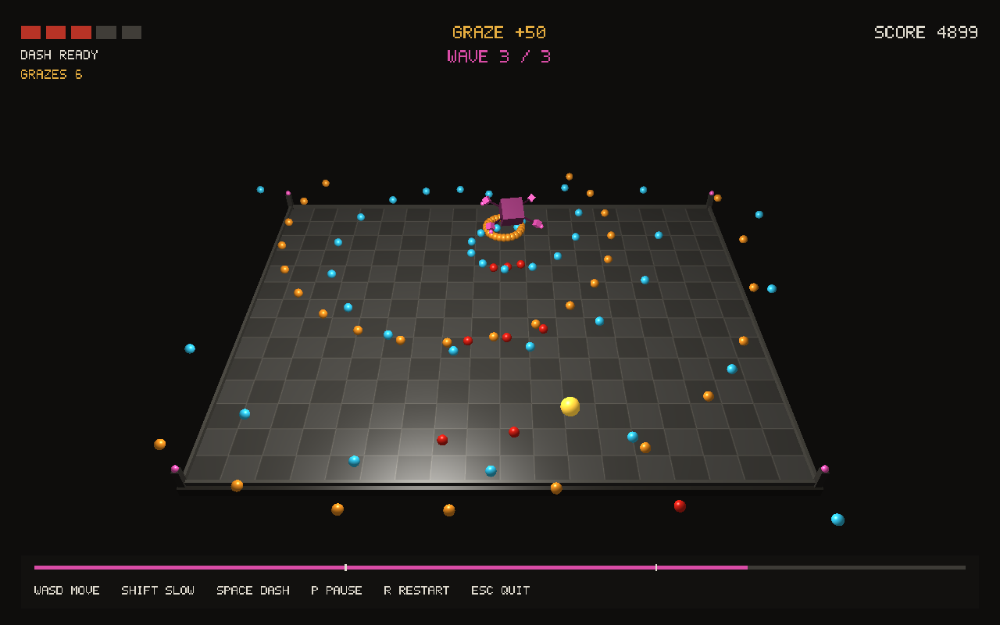

# Orbit Bullet Hell

**Course:** Computer Graphics Fundamentals (OKG 2214)  
**Team:** Mukhammed Sailau and Ali Turlas, IT-2507  
**Instructor:** Saleshova Sabina  
**Date:** 14 November 2026

**Demonstration:** VIDEO_URL_PENDING_PUBLIC_UPLOAD

## 1. Introduction

Orbit Bullet Hell is a short C++ and OpenGL game in which the player survives a 60-second encounter with a moving boss. It was made to demonstrate the graphics pipeline taught in Computer Graphics Fundamentals while still being a complete interactive application. The player moves on an arena, avoids projectiles, gains points for surviving and narrowly missing a shot, and can slow down or dash to react to difficult patterns. The scene gives us a concrete reason to use geometry, transformations, a perspective camera, lighting, texture coordinates, GPU buffers, animation, and a two-dimensional heads-up display (HUD). Figure 1 shows an actual frame from the tested build.

Figure 1 illustrates the 3D arena, textured floor, hierarchical boss, moving projectiles, player, and HUD. The magenta wave label and progress bar identify wave 3; red shots are aimed, amber shots are radial, and cyan shots belong to the rotating stream. The capture was produced by `--smoke-wave 3`, a rendering test shortcut that starts at the third-wave boundary. It does not claim a player survived the earlier waves. The YouTube demonstration and code walkthrough will be available at the link on the title page after the team publishes it.

## 2. Literature Review and Background

The project uses a small part of the computer graphics literature as background, with methods chosen for clarity and real-time performance. Gouraud's work [1] established smooth interpolation across polygonal surfaces. Phong [2] described illumination with ambient, diffuse, and specular components. Our fragment shader computes these three terms per fragment, with a half-vector specular term for a simple highlight. Cook and Torrance [3] and Schlick [4] describe more detailed reflectance models. We did not implement a physically based material model because the game uses a few matte, strongly colored shapes and the course calls for explainable shader techniques.

Blinn and Newell [5] provide early texture-mapping background. The game creates a small checkerboard image in memory and maps it to the arena floor with UV coordinates. Bourque and Dudek [6] study much more flexible procedural textures, while Perlin [7] and Lagae et al. [8] explain procedural noise. Our checker is intentionally simpler: it shows the UV and texture sampling stages without external images or a complex generator. The floor shader also draws a small anti-aliased grid from world coordinates to help players judge distance.

Reeves [9] introduced particle systems as an approach to animated visual effects. We currently render each shot as a small sphere and use simple color and emission to make it readable; a particle trail would be a future enhancement. Sloan et al. [10], Ritschel et al. [11], Hasenfratz et al. [12], and Crassin et al. [13] show approaches for more complete lighting, indirect illumination, or shadows. Such effects could improve depth cues, but our single light and depth buffer are sufficient for this small arena and easier to inspect in the code.

Collision work by Klosowski et al. [14] and Teschner et al. [15] shows techniques for larger or deformable scenes. Our projectiles and player are rigid spheres. Checking the distance from each projectile center to the player center once per fixed update is sufficient for the tested active projectile count. The comparison matters because it explains why we did not add a spatial tree or physics engine to a small student project.

All 15 research articles appear in five journals listed as Q1 or Q2 in the 2024 Journal Citation Reports JIF quartiles [16]. The categories are Computer Science, Software Engineering for four venues and Computer Science, Hardware & Architecture for IEEE Transactions on Computers. These are venue rankings for that year, not article-level ratings or historical ranks at publication. The venue checks and DOI links are recorded in `docs/RESEARCH_NOTES.md`. These papers are contextual sources; we do not claim to implement their advanced rendering or collision algorithms.

## 3. Project Description

### 3.1 Objective

Create a playable OpenGL 3.3 game that clearly demonstrates the course's shader pipeline, matrices, 3D geometry, lighting, texturing, animation, and user input. The round should have a beginning, success or failure state, and a restart control.

### 3.2 Problem Statement

A static scene can demonstrate drawing, but it gives little evidence that the graphics and interaction work together. A survival game requires readable motion, camera placement, collision feedback, and a HUD. The main design problem was keeping these systems understandable and responsive without a large engine or assets.

### 3.3 Scope and Rules

The player uses WASD on the X/Z arena plane, Shift for slower precision movement, Space to dash in the held direction, P to pause, R to restart, and Escape to quit. Five health points and a 60-second timer define the round. Waves change after 20 and 40 seconds. The boss fires an aimed three-shot fan and radial volleys; the second wave adds a rotating stream, and the third sends opposite streams faster. A close pass without collision earns 50 graze points once per projectile. A dash gives brief protection and has a 2.5-second cooldown. The win condition is survival to 60 seconds; zero health is a loss. We excluded sound, online play, imported 3D models, and complex physics.

## 4. Technical Implementation

### 4.1 Tools and Technologies Used

C++17 holds the game state and updates it. GLFW creates the window and reads keyboard input. GLEW loads OpenGL functions. GLM supplies vectors and matrices. OpenGL 3.3 draws the scene, and GLSL 330 vertex and fragment shaders calculate positions, lighting, texture color, and the HUD. CMake builds the application and a small rules test executable. GitHub records each contributor's actual commits, including the preserved history from the original repository. No game engine or purchased asset pack is used.

### 4.2 Development Process and Teamwork

The team started with a playable core, then added dash and graze mechanics and made the three waves distinct. Mukhammed developed gameplay rules, tests, integration, and the report and presentation materials. Ali built the hierarchical boss and wave visual feedback in `main.cpp`, tested all three rendering waves, and reviewed the report. The existing GLSL shader files did not change in Ali's rendering pass. The students shared changes through Git branches, reviewed the integrated work, and ran the build and tests after integration. Each person committed under their own identity. Their contributions are described by the work completed, not just the number of commits.

Codex assisted Mukhammed with planning, implementation suggestions, debugging, documentation, and preparation of report materials. Ali also used Codex while implementing, validating, and documenting his rendering pass. The students must read, test, and be able to explain every submitted change. This assistance is disclosed here as required by the syllabus; commit authorship identifies the student directing the work.

### 4.3 Algorithms and Techniques

The game logic advances in fixed steps of 1/120 second. The render loop collects real elapsed time and calls the update method as many times as needed. This keeps movement and collisions independent of display frame rate. Input direction is normalized so diagonal movement has the same speed as straight movement. Position is clamped to the arena bounds.

Each bullet stores position and velocity. At each step, position changes by velocity multiplied by the time step. A collision occurs when the squared center distance is no greater than the squared sum of the player and bullet radii. A larger radius detects a near miss after a non-hit. The squared comparison avoids a square root in the frequent collision loop. Timers determine when aimed, radial, and rotating shots spawn. The boss position and visual rotation use sine or elapsed-time angles. Shots outside the arena are removed so the active list stays bounded.

For rendering, model matrices place and size meshes, a `lookAt` view matrix aims the camera, and a perspective matrix projects the 3D scene. The vertex shader transforms each vertex through model, view, and projection matrices. Ali's boss uses a translated and rotating parent matrix. Core and heart transforms are children of that parent; orbit pivots hold arms and satellites; small beacons inherit each satellite's transform. The code composes parent and local matrices before drawing. Scale is applied only at the mesh leaves so a scaled core cannot stretch its sibling orbits. The vertex shader uses the inverse transpose of the model matrix for normals after nonuniform scaling. The fragment shader samples the floor texture and applies a local light. The HUD is built from colored quads, including a tiny 5-by-7 bitmap-style font, then drawn with alpha blending after the 3D scene.

## 5. Graphics and Rendering

### 5.1 2D and 3D Rendering

The arena and boss use a cube mesh; the player and bullets use a sphere mesh generated from latitude and longitude. Vertex Array Objects and Vertex Buffer Objects store vertex positions, normals, and UVs on the GPU. Depth testing keeps nearer 3D surfaces in front. The HUD uses separate two-dimensional triangles and an orthographic projection after depth testing is temporarily disabled. This follows the pipeline in lectures L1–L5 and L7.

### 5.2 Lighting and Shading

The fragment shader calculates a normal, light direction, view direction, diffuse dot product, and a half-vector specular highlight. Ambient light prevents shadowed faces from becoming fully black. An emission value brightens the boss and projectiles so the attacks remain visible. The scene has one fixed light above and to one side of the arena. This is a local lighting model, without cast shadows or global illumination. The final color also fades slightly with distance. These choices follow the course's shading lecture and the introductory shading literature [1–4].

### 5.3 Texturing and Animation

The checkerboard floor texture is generated in C++ as a 64-by-64 RGB image, uploaded with `glTexImage2D`, and sampled through UV coordinates in the fragment shader. `GL_REPEAT` repeats it across the floor. A separate grid is computed from world coordinates with `fract`, `fwidth`, and `smoothstep`; it is a simple procedural visual effect. The boss's parent bobs and rotates, its satellites orbit faster and farther in later waves, and the beacons inherit the satellites' motion. These movements use elapsed game time, so pause and restart also control the animation. Wave 1 uses amber, wave 2 blue, and wave 3 magenta on the boss, arena corner lights, wave label, and progress bar. Cyan spiral bullets remain distinct from red aimed bullets and amber radial bullets. The player flashes after damage and brightens during dash or graze; the HUD marks health, score, dash readiness, controls, and round progress. These features connect to lectures L8–L10.

## 6. Testing and Evaluation

### 6.1 Testing Methodology

The CMake `game_rules` test checks movement speed, arena bounds, dash protection and cooldown, collision grace period, one-time graze scoring, pause and restart, distinct wave patterns, loss, and survival to the 60-second win. It passed on the integrated code. Three OpenGL smoke checks each ran 360 rendered frames at the wave 1, 2, and 3 boundaries, checked GL errors, and saved screenshots. All passed. We also recorded and inspected real gameplay footage showing movement, pause, game over, and restart. The video separately labels wave-2 and wave-3 smoke frames so a test shortcut is not mistaken for a full playthrough. A student should still play the full round on the presentation computer and check controls, readability, window size, and the win and loss screens; a scripted recording cannot replace that human review.

### 6.2 Performance Evaluation

The final integrated wave-3 smoke run on 9 November 2026 took 2.690 seconds for 360 frames, or about 133.8 frames per process wall second. Maximum resident memory for the child process was about 206.5 MiB, and 105 projectiles were active at the end. The machine had an AMD Ryzen 7 7735HS. Rendering used Mesa 26.2.3 `llvmpipe` through Xvfb at 1280 by 800 pixels, with vsync off. This measures CPU software rendering and includes process initialization; it is not a dedicated-GPU FPS benchmark or a complete 60-second session. It is one development run, so other computers may differ.

Ali reduced the shared sphere mesh from 20 × 28 to 12 × 16 rows and columns, changing each sphere from 1,120 to 384 generated triangles while retaining smooth normals, UVs, and the same collision radii. On his separate Intel Core i5-12450HX/Mesa llvmpipe setup, three interleaved measured wave-3 runs per version had median process wall times of 4.947 seconds before and 2.179 seconds after the mesh change, about a 56% reduction for that software-rendered workload. The same 360 frames and 105 end-of-check projectiles were present in both versions; warm-ups were excluded. His raw observations are in `docs/performance/sphere-benchmark.json`. This comparison does not establish real-play hardware FPS.

### 6.3 Issues and Debugging

The project needed a headless rendering path for repeatable automated checks. Xvfb with Mesa's software OpenGL renderer let us compile shaders, draw frames, check errors, and capture Figure 1. A focus-loss event initially paused the game during recording, so the recording script now restores focus and resumes play before capturing. The game uses a fixed update step to reduce differences between fast and slow displays. Projectile removal limits growth of the bullet list. Moving diagonal input is normalized, and pause freezes timers, preventing inconsistent play. The local demo draft was recorded from the optimized build.

## 7. Conclusion and Future Work

Orbit Bullet Hell combines a complete 60-second game loop with the graphics techniques required by the course: geometry, hierarchical transformations, camera projection, GPU buffers, fragment shading, texturing, procedural detail, animation, and a HUD. The rules and all three OpenGL wave checks pass. A smaller sphere mesh improved the software-rendered projectile-heavy scene while preserving the tested gameplay rules. The main limitation is simple lighting. Future work could add sound, more boss forms, particle effects, shadows, and a broader hardware performance comparison, if they remain understandable and useful to gameplay. The final team review will confirm the public demo link before submission.

## 8. References

[1] H. Gouraud, “Continuous Shading of Curved Surfaces,” *IEEE Transactions on Computers*, C-20(6), 623–629, 1971. https://doi.org/10.1109/T-C.1971.223313  
[2] B. T. Phong, “Illumination for computer generated pictures,” *Communications of the ACM*, 18(6), 311–317, 1975. https://doi.org/10.1145/360825.360839  
[3] R. L. Cook and K. E. Torrance, “A Reflectance Model for Computer Graphics,” *ACM Transactions on Graphics*, 1(1), 7–24, 1982. https://doi.org/10.1145/357290.357293  
[4] C. Schlick, “An Inexpensive BRDF Model for Physically-based Rendering,” *Computer Graphics Forum*, 13(3), 233–246, 1994. https://doi.org/10.1111/1467-8659.1330233  
[5] J. F. Blinn and M. E. Newell, “Texture and reflection in computer generated images,” *Communications of the ACM*, 19(10), 542–547, 1976. https://doi.org/10.1145/360349.360353  
[6] E. Bourque and G. Dudek, “Procedural Texture Matching and Transformation,” *Computer Graphics Forum*, 23(3), 461–468, 2004. https://doi.org/10.1111/j.1467-8659.2004.00777.x  
[7] K. Perlin, “Improving noise,” *ACM Transactions on Graphics*, 21(3), 681–682, 2002. https://doi.org/10.1145/566654.566636  
[8] A. Lagae et al., “A Survey of Procedural Noise Functions,” *Computer Graphics Forum*, 29(8), 2579–2600, 2010. https://doi.org/10.1111/j.1467-8659.2010.01827.x  
[9] W. T. Reeves, “Particle Systems—a Technique for Modeling a Class of Fuzzy Objects,” *ACM Transactions on Graphics*, 2(2), 91–108, 1983. https://doi.org/10.1145/357318.357320  
[10] P.-P. Sloan, J. Kautz, and J. Snyder, “Precomputed radiance transfer for real-time rendering in dynamic, low-frequency lighting environments,” *ACM Transactions on Graphics*, 21(3), 527–536, 2002. https://doi.org/10.1145/566654.566612  
[11] T. Ritschel et al., “The State of the Art in Interactive Global Illumination,” *Computer Graphics Forum*, 31(1), 160–188, 2012. https://doi.org/10.1111/j.1467-8659.2012.02093.x  
[12] J.-M. Hasenfratz et al., “A Survey of Real-time Soft Shadows Algorithms,” *Computer Graphics Forum*, 22(4), 753–774, 2003. https://doi.org/10.1111/j.1467-8659.2003.00722.x  
[13] C. Crassin et al., “Interactive Indirect Illumination Using Voxel Cone Tracing,” *Computer Graphics Forum*, 30(7), 1921–1930, 2011. https://doi.org/10.1111/j.1467-8659.2011.02063.x  
[14] J. Klosowski et al., “Efficient collision detection using bounding volume hierarchies of k-DOPs,” *IEEE Transactions on Visualization and Computer Graphics*, 4(1), 21–36, 1998. https://doi.org/10.1109/2945.675649  
[15] M. Teschner et al., “Collision Detection for Deformable Objects,” *Computer Graphics Forum*, 24(1), 61–81, 2005. https://doi.org/10.1111/j.1467-8659.2005.00829.x

[16] 2024 Journal Citation Reports JIF quartile list, institutional PDF released June 2025. https://cdn.umfcluj.ro/uploads/2024/08/JCR_2024_iunie2025.pdf

## 9. Appendix

Build: `cmake -S . -B build -DCMAKE_BUILD_TYPE=Release`, then `cmake --build build`. Run `./build/bullethell` and check rules with `ctest --test-dir build --output-on-failure`. The README gives controls and the virtual-display smoke-test command. Source and shaders are in the repository. The written report follows the supplied Computer Graphics Fundamentals final report template; course lectures L1–L10 guided the implementation topics.
